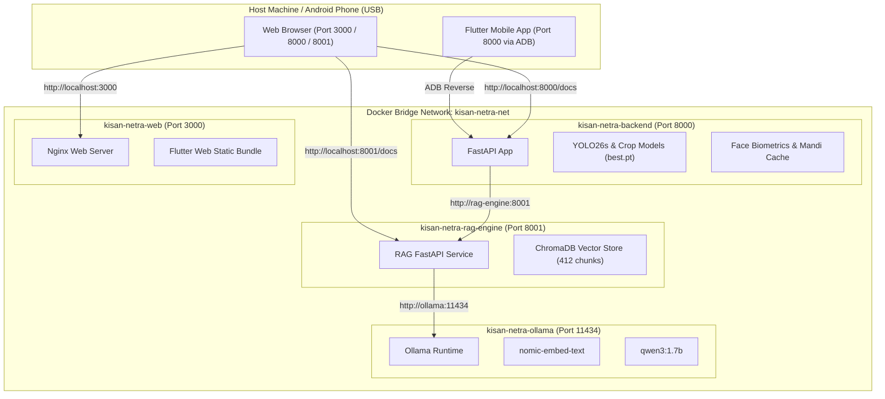

# KISAN NETRA — Complete Docker & Docker Hub Deployment Guide

This guide walks you through containerizing the entire **Kisan Netra (CHIP TO CROP)** ecosystem, running all services with Docker Compose, and publishing your container images to **Docker Hub** so anyone can pull and run your project with a single command.

---

## 1. System Architecture & Container Breakdown

Kisan Netra consists of 4 decoupled services orchestrated together on a shared bridge network (`kisan-netra-net`):



### The 4 Dockerized Services

| Container Name | Service | Base Image | Port | Persistence / Volume |
| :--- | :--- | :--- | :---: | :--- |
| **`kisan-netra-ollama`** | Ollama LLM & Embeddings | `ollama/ollama:latest` | `11434` | `kisan_netra_ollama_models` |
| **`kisan-netra-rag-engine`** | Agricultural RAG & ChromaDB | `python:3.12-slim` | `8001` | `kisan_netra_chroma_data` |
| **`kisan-netra-backend`** | Main Backend & YOLO Models | `python:3.11-slim` | `8000` | `kisan_netra_backend_data` |
| **`kisan-netra-web`** | Flutter Web Dashboard | `nginx:alpine` | `3000` | Static web bundle |

---

## 2. Key Docker Concepts Used in This Project

Before running commands, here are the key engineering techniques implemented in our Dockerfiles:

1. **Lightweight CPU PyTorch Installation (`backend/Dockerfile`)**:
   Standard `pip install ultralytics` downloads ~3.5 GB of Nvidia CUDA wheels. In `backend/Dockerfile`, we explicitly run:
   ```dockerfile
   RUN pip install --no-cache-dir torch torchvision --index-url https://download.pytorch.org/whl/cpu
   ```
   *Result:* Cuts image build time by 75% and saves over 2.5 GB of disk space.

2. **Self-Contained Model Packaging**:
   All 3 trained YOLO `.pt` weights live inside `backend/models/`:
   - `models/yolo26s/best.pt` (Leaf disease)
   - `models/crop_disease/best.pt` (Crop & fruit disease)
   - `models/quality/best.pt` (Produce freshness grading)
   They are baked directly into the image so the container is 100% self-sufficient.

3. **Layer Caching Optimization**:
   `requirements.txt` is copied and installed **before** copying application code. When you change code, Docker reuses the cached library layers and rebuilds in seconds.

4. **Multi-Stage Build (`Dockerfile.web`)**:
   Flutter compilation takes place in a large builder stage with Dart/Flutter SDKs. The final runtime container copies only the compiled static HTML/JS files into a tiny 25 MB Alpine Nginx image.

5. **Automated One-Shot Model Puller (`ollama-init`)**:
   In `docker-compose.yml`, an init container automatically calls `ollama pull nomic-embed-text` and `ollama pull qwen3:1.7b` on first startup so you never have to manually run `docker exec` commands.

---

## 3. Prerequisites

1. **Start Docker Desktop**:
   Open Docker Desktop on Windows. Ensure the whale icon in your system tray is steady (green).
   Verify by opening PowerShell:
   ```powershell
   docker ps
   ```

2. **(Optional) Configure Docker Desktop Memory**:
   Since Ollama (`qwen3:1.7b`) and ChromaDB run in containers, allocating at least **6 GB - 8 GB of RAM** in *Docker Desktop Settings → Resources* ensures smooth inference.

---

## 4. Step-by-Step: Running with Docker Compose (Local Stack)

### Step 4.1: (Optional) Provide External API Keys
Copy the example environment file for the backend:
```powershell
Copy-Item backend\.env.example backend\.env
```
*(If you do not have cloud keys yet, the app still works! YOLO models and local Ollama RAG run completely offline.)*

### Step 4.2: Build and Start All Backend & AI Containers
From the project root:
```powershell
docker compose up --build -d
```

> **What this command does:**
> - Builds `kisan-netra-backend` and `kisan-netra-rag-engine` images.
> - Starts `ollama` on port `11434`.
> - Launches `ollama-init` to download `nomic-embed-text` and `qwen3:1.7b` into persistent storage.
> - Launches `rag-engine` on port `8001` once Ollama is healthy.
> - Launches `backend` on port `8000` once RAG engine is healthy.

### Step 4.3: Watch Service Logs
```powershell
docker compose logs -f
```
*(Press `Ctrl + C` anytime to exit log streaming; containers remain running in background.)*

### Step 4.4: Check Container Health
```powershell
docker compose ps
```
You should see all containers running with state `healthy` or `running`.

---

## 5. Verifying the Running Containers

Open your browser and test the interactive API documentation:

| Service | URL | Purpose |
| :--- | :--- | :--- |
| **Backend Swagger UI** | [http://localhost:8000/docs](http://localhost:8000/docs) | Test Auth, YOLO inference, Mandi, Sarvam |
| **Backend Health** | [http://localhost:8000/health](http://localhost:8000/health) | Verify Supabase, Face++, YOLO status |
| **RAG Engine Swagger UI** | [http://localhost:8001/docs](http://localhost:8001/docs) | Test Q&A retrieval and disease advisories |
| **RAG Engine Health** | [http://localhost:8001/health](http://localhost:8001/health) | Verify Ollama link and Chroma chunk count |

---

## 6. Connecting Your Physical Android Phone to Docker

If you run the Flutter app on a physical Android device connected via USB, run ADB port forwarding so your phone can reach the Docker containers on your PC:

```powershell
adb reverse tcp:8000 tcp:8000
adb reverse tcp:8001 tcp:8001
flutter run
```

---

## 7. (Optional) Running the Flutter Web Dashboard Container

To also run the Flutter web client in a container:
```powershell
docker compose --profile frontend up --build -d
```
Then open your browser at:
[http://localhost:3000](http://localhost:3000)

---

## 8. Stopping and Managing Containers

```powershell
# Stop all containers (preserves vector database and downloaded models)
docker compose stop

# Restart containers
docker compose start

# Stop and remove containers (keeps volumes safe)
docker compose down

# Stop and erase all downloaded models and databases (full reset)
docker compose down -v
```

---

## 9. Step-by-Step: Publishing Images to Docker Hub

Publishing your images to Docker Hub allows anyone in the world (or your cloud deployment servers) to run Kisan Netra without needing your source code or building locally.

### Step 9.1: Create a Docker Hub Account
If you don't already have one, create a free account at [https://hub.docker.com](https://hub.docker.com).
Note your **Docker Hub Username** (e.g., `madhanbv`).

### Step 9.2: Log In to Docker Hub from Terminal
```powershell
docker login
```
Enter your Docker Hub username and password (or Personal Access Token).

### Step 9.3: Build Images with Your Docker Hub Username Tag
Replace `<YOUR_DOCKERHUB_USERNAME>` with your actual username (e.g., `madhanbv`):

```powershell
# 1. Build the Backend Image (FastAPI + YOLO Models)
docker build -t <YOUR_DOCKERHUB_USERNAME>/kisan-netra-backend:latest -t <YOUR_DOCKERHUB_USERNAME>/kisan-netra-backend:v1.0.0 ./backend

# 2. Build the RAG Engine Image (ChromaDB + Agricultural Corpus)
docker build -t <YOUR_DOCKERHUB_USERNAME>/kisan-netra-rag-engine:latest -t <YOUR_DOCKERHUB_USERNAME>/kisan-netra-rag-engine:v1.0.0 ./rag_engine

# 3. (Optional) Build the Flutter Web Frontend Image
docker build -f Dockerfile.web -t <YOUR_DOCKERHUB_USERNAME>/kisan-netra-frontend:latest -t <YOUR_DOCKERHUB_USERNAME>/kisan-netra-frontend:v1.0.0 .
```

### Step 9.4: Push Images to Docker Hub
Push both the `latest` tag and the version `v1.0.0` tag:

```powershell
# Push Backend
docker push <YOUR_DOCKERHUB_USERNAME>/kisan-netra-backend:latest
docker push <YOUR_DOCKERHUB_USERNAME>/kisan-netra-backend:v1.0.0

# Push RAG Engine
docker push <YOUR_DOCKERHUB_USERNAME>/kisan-netra-rag-engine:latest
docker push <YOUR_DOCKERHUB_USERNAME>/kisan-netra-rag-engine:v1.0.0

# (Optional) Push Web Frontend
docker push <YOUR_DOCKERHUB_USERNAME>/kisan-netra-frontend:latest
docker push <YOUR_DOCKERHUB_USERNAME>/kisan-netra-frontend:v1.0.0
```

Once pushed, your images are publicly available on Docker Hub at:
`https://hub.docker.com/r/<YOUR_DOCKERHUB_USERNAME>/kisan-netra-backend`
`https://hub.docker.com/r/<YOUR_DOCKERHUB_USERNAME>/kisan-netra-rag-engine`

---

## 10. Deploying on Any Remote Cloud Server (AWS, GCP, DigitalOcean, VPS)

Once images are on Docker Hub, running on any server requires **only one file**: `docker-compose.hub.yml`!

1. On your remote server (Ubuntu / Debian / CentOS), install Docker & Docker Compose:
   ```bash
   curl -fsSL https://get.docker.com | sh
   ```
2. Download `docker-compose.hub.yml`:
   ```bash
   wget https://raw.githubusercontent.com/MadhanBV/KISAN-NETRA-CHIP_TO_CROP-PROJECT/main/docker-compose.hub.yml
   ```
3. Set your Docker Hub username and launch:
   ```bash
   export DOCKERHUB_USER=<YOUR_DOCKERHUB_USERNAME>
   docker compose -f docker-compose.hub.yml up -d
   ```
*Everything downloads from Docker Hub and starts automatically!*

---

## 11. Troubleshooting Common Docker Issues

| Issue | Cause | Solution |
| :--- | :--- | :--- |
| `failed to connect to docker API` | Docker Desktop is not running | Start Docker Desktop from the Start menu and wait until the engine says "Running". |
| `port 8000 or 8001 already in use` | Local Python servers are already running | Stop local Uvicorn processes or run `Get-Process python \| Stop-Process` in PowerShell before launching Docker. |
| `Ollama model pull timeout` | Slow internet during first pull | The `ollama-init` service will retry, or you can run `docker exec -it kisan-netra-ollama ollama pull nomic-embed-text` manually. |
| `Cannot find models/best.pt` | Path resolution issue | All models are now located inside `backend/models/` and bundled inside the Docker image automatically. |
