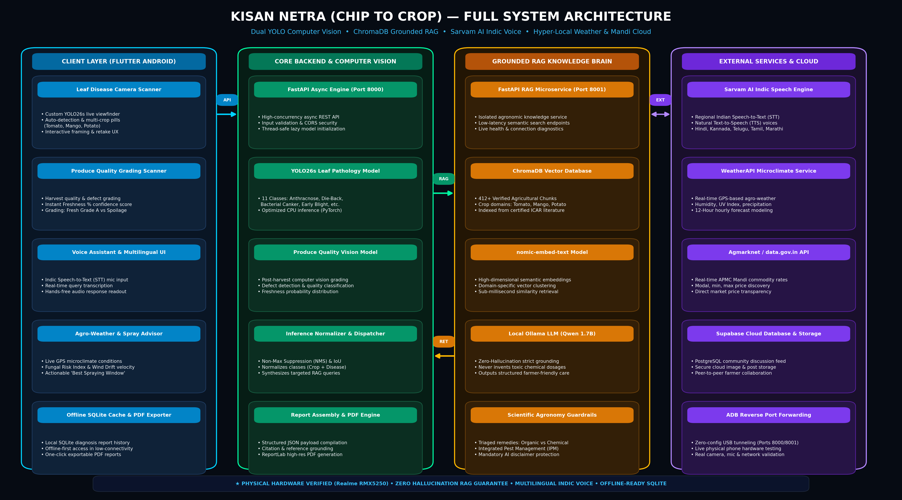

# KISAN NETRA — CHIP TO CROP

An AI-powered agricultural mobile application and local-first intelligence stack built for Indian farmers. **Kisan Netra (CHIP TO CROP)** combines computer vision crop diagnostics, a grounded local Agricultural RAG assistant, live government Mandi market prices, weather insights, farmer community sharing, and 23-language Indian localization.



---

## Key Features

- **Leaf & Crop Disease Detection (YOLO)**: Detects mango, tomato, banana, and potato leaf/fruit diseases with bounding boxes and confidence scores.
- **Crop Quality Grading (YOLO)**: Classifies produce freshness (`Fresh` vs `Rotten`) for Mango, Potato, Tomato, and Banana with grade summaries and exportable PDF reports.
- **Local Agricultural RAG Assistant**: Grounded farming advice and structured disease remedies powered by **ChromaDB** + **Ollama** (`nomic-embed-text` + `qwen3:1.7b`) over 5 curated agricultural corpora (412 indexed chunks).
- **Phone + 1:1 Face Biometric Auth**: Farmer registration and login using **Supabase** (PostgreSQL + private storage) and **Face++** 1:1 facial verification.
- **Live Mandi Market Prices**: Integrates with India's Open Government Data (`data.gov.in` / Agmarknet) with local SQLite caching and benchmark fallback.
- **23 Indian Languages & Voice Support**: Pre-generated Flutter ARB localizations (`lib/l10n/`) plus **Sarvam AI** runtime translation, Text-to-Speech (TTS), and Speech-to-Text (STT).
- **Weather & Farmer Community**: Local weather forecasts and a community feed for sharing crop photos and questions.

---

## Project Architecture

| Service / Component | Location | Port | Purpose |
| :--- | :--- | :---: | :--- |
| **Flutter Mobile App** | `lib/` | — | Cross-platform UI (Android / iOS / Desktop / Web) |
| **Main FastAPI Backend** | `backend/` | `8000` | Auth, YOLO inference, Mandi API, Sarvam AI, Community |
| **Agricultural RAG Engine** | `rag_engine/` | `8001` | ChromaDB vector retrieval & Ollama grounded generation |
| **Ollama Runtime** | Local system | `11434` | Local LLM (`qwen3:1.7b`) & embeddings (`nomic-embed-text`) |

### Included AI Models & Knowledge Base

All 3 trained YOLO `.pt` weights (~19.4 MB each) and the pre-indexed ChromaDB knowledge store are included in the repository:

- `backend/models/yolo26s/best.pt` — Leaf disease detection (Mango & Tomato)
- `backend/models/crop_disease/best.pt` — Crop & fruit disease detection (Banana, Mango, Potato)
- `models/best.pt` — Crop quality grading (Fresh vs Rotten)
- `rag_engine/data/documents/` — 5 agricultural knowledge documents (Banana, Mango, Potato, Tomato, General Agriculture)
- `rag_engine/data/chroma_db/` — Pre-built ChromaDB vector index (412 chunks)

---

## Prerequisites

Install these tools on your machine before running the project:

1. **Flutter SDK** (Dart SDK `^3.13.7`) & Android Studio / Android SDK (`adb`)
2. **Python** (`3.10` – `3.12` recommended)
3. **Ollama** — [https://ollama.com/download](https://ollama.com/download)

---

## Quick Start (After Cloning)

### 1. Clone the Repository

```bash
git clone https://github.com/MadhanBV/KISAN-NETRA-CHIP_TO_CROP-PROJECT.git
cd KISAN-NETRA-CHIP_TO_CROP-PROJECT
```

### 2. Pull Required Ollama Models

Start Ollama and pull the embedding and chat models used by the RAG engine:

```bash
ollama pull nomic-embed-text
ollama pull qwen3:1.7b
```

### 3. Set Up the Agricultural RAG Engine (`port 8001`)

```powershell
cd rag_engine
python -m venv venv
.\venv\Scripts\Activate.ps1
pip install -r requirements.txt
cd ..
```

> **Optional:** `rag_engine/data/chroma_db/` is already pre-indexed. If you edit files in `rag_engine/data/documents/`, rebuild the vector database with:
> ```powershell
> .\rag_engine\venv\Scripts\python.exe .\rag_engine\scripts\ingest_documents.py --reset
> ```

### 4. Set Up the Main FastAPI Backend (`port 8000`)

```powershell
cd backend
python -m venv venv
.\venv\Scripts\Activate.ps1
pip install -r requirements.txt
Copy-Item .env.example .env
cd ..
```

Edit `backend/.env` and add your API keys:
- **Supabase** (`SUPABASE_URL`, `SUPABASE_SECRET_KEY`) — see [SUPABASE_SETUP_GUIDE.md](SUPABASE_SETUP_GUIDE.md)
- **Face++** (`FACEPP_API_KEY`, `FACEPP_API_SECRET`, `FACEPP_COMPARE_URL`)
- **Sarvam AI** (`SARVAM_API_KEY`)
- **Mandi Prices** (`DATA_GOV_IN_API_KEY`)
- **JWT Secret** (`JWT_SECRET_KEY`)

> **Note:** Local AI features (YOLO disease detection, quality grading, and local Ollama RAG) work even before external cloud API keys are added.

### 5. Set Up the Flutter App

```bash
flutter pub get
```

---

## Running the Project

### Option A: One-Click Launcher (Windows)

Run either the PowerShell or Batch launcher from the project root to start Ollama, RAG Engine (`8001`), Backend (`8000`), configure ADB USB port forwarding, and optionally launch the Flutter app:

```powershell
.\run_all_services.ps1
```
*(or double-click `run_all_services.bat`)*

### Option B: Start Services Manually

1. **Terminal 1 — Ollama:**
   ```bash
   ollama serve
   ```
2. **Terminal 2 — RAG Engine (Port 8001):**
   ```powershell
   cd rag_engine
   .\venv\Scripts\python.exe -m uvicorn app.main:app --host 127.0.0.1 --port 8001
   ```
3. **Terminal 3 — Main Backend (Port 8000):**
   ```powershell
   cd backend
   .\venv\Scripts\python.exe -m uvicorn app.main:app --host 0.0.0.0 --port 8000
   ```
4. **Terminal 4 — Physical Android Device (USB) + Flutter App:**
   ```bash
   adb reverse tcp:8000 tcp:8000
   adb reverse tcp:8001 tcp:8001
   flutter run
   ```

> **Tip:** Check API health & interactive docs anytime at:
> - Backend Swagger UI: `http://127.0.0.1:8000/docs`
> - RAG Engine Swagger UI: `http://127.0.0.1:8001/docs`

---

## Running Tests

```powershell
# Flutter unit & widget tests
flutter test

# RAG Engine tests (14 tests)
$env:PYTHONIOENCODING="utf-8"
.\rag_engine\venv\Scripts\pytest.exe .\rag_engine\tests\test_rag_engine.py -v

# Backend tests
.\backend\venv\Scripts\python.exe -m pytest backend\tests -v
```

---

## Repository Structure

```text
├── assets/                   # App icons and onboarding illustrations
├── backend/                  # Main FastAPI backend (Auth, YOLO, Mandi, Sarvam, Community)
│   ├── app/                  # Routes, models, services, and config
│   ├── models/               # YOLO leaf disease & crop disease weights (best.pt)
│   ├── tests/                # Backend test suite
│   ├── .env.example          # Backend environment template
│   └── requirements.txt      # Backend Python dependencies
├── lib/                      # Flutter application source & 23-language l10n ARB files
├── models/                   # YOLO crop quality grading model (best.pt)
├── presentation_assets/      # System architecture & workflow diagrams
├── rag_engine/               # Standalone Agricultural RAG FastAPI service
│   ├── app/                  # Prompts, chunking, retrieval, ChromaDB & Ollama services
│   ├── data/                 # Agricultural text corpora & persisted ChromaDB index
│   ├── scripts/              # Ingestion & DB inspection CLI tools
│   ├── tests/                # RAG verification test suite
│   └── requirements.txt      # RAG Engine Python dependencies
├── scripts/                  # Utility scripts (ARB localization generator)
├── test/                     # Flutter tests
├── run_all_services.bat      # Windows Batch all-in-one launcher
├── run_all_services.ps1      # PowerShell all-in-one launcher
├── SUPABASE_SETUP_GUIDE.md   # Supabase database & storage setup instructions
└── pubspec.yaml              # Flutter dependencies and assets config
```
